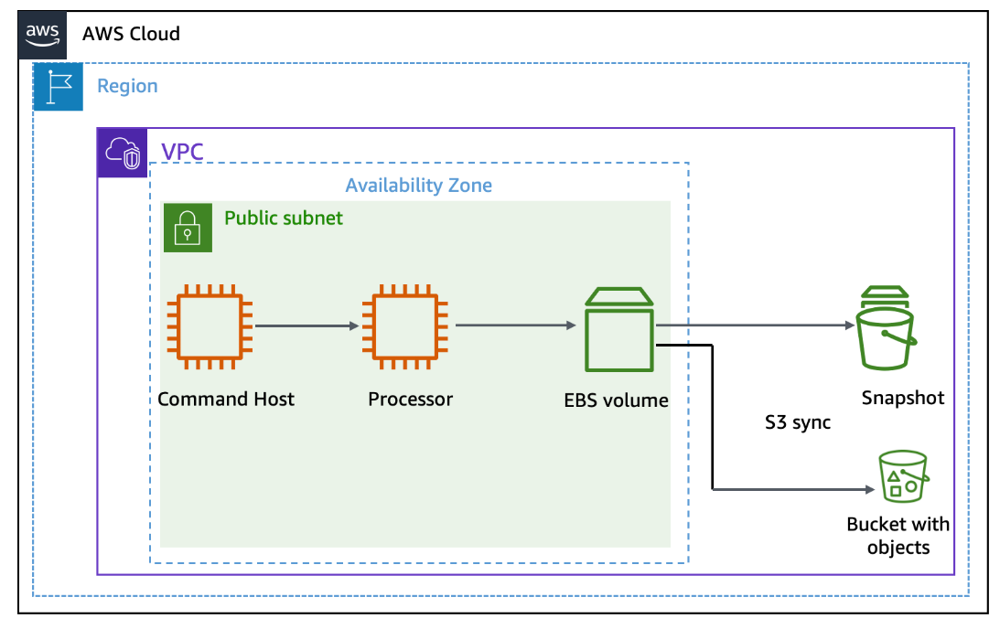
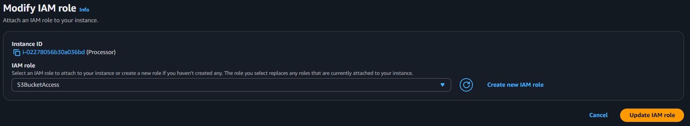
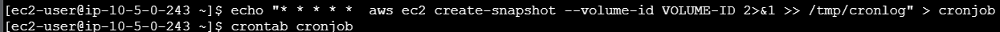
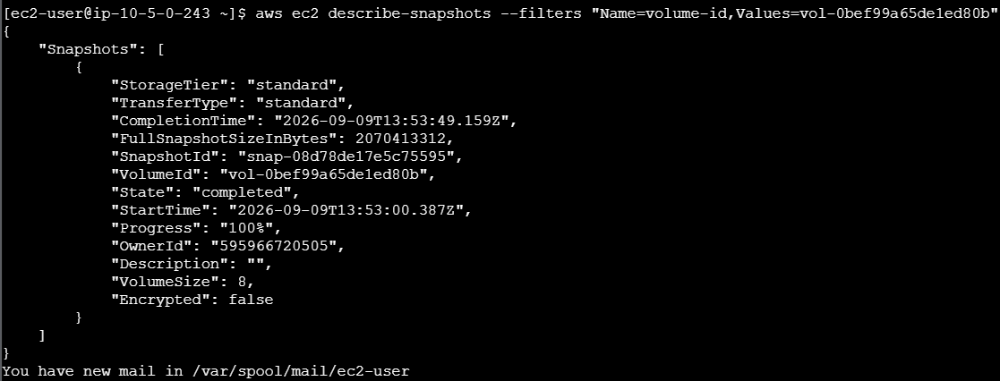
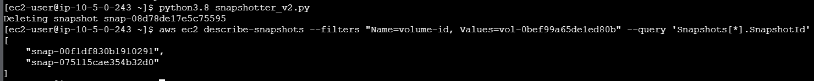
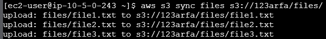
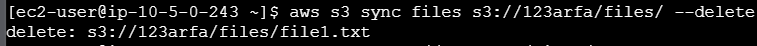
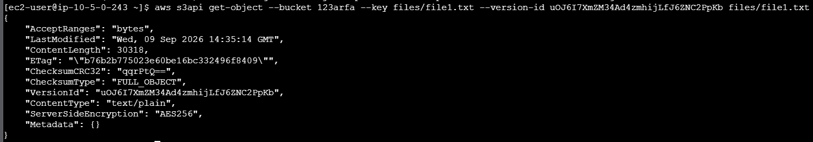

# AWS Storage Lifecycle Management & Automated Disaster Recovery

A hands-on implementation demonstrating Automated Storage Retention, Cost Optimization (FinOps), Identity Security (IAM), and Disaster Recovery (DR) using AWS CLI, Python, Linux Cron, Amazon EBS, and Amazon S3.

1. SYSTEM ARCHITECTURE & TECH STACK

| CATEGORY             | SERVICES & TOOLS                | OPERATIONAL VALUE                                  |
| :------------------- | :------------------------------ | :------------------------------------------------- |
| Compute & Storage    | AWS EC2, Amazon EBS, Amazon S3  | Core compute layer, block storage, object storage. |
| Automation & FinOps  | Python 3.8, Linux Cron, Bash    | Automated EBS snapshot creation & retention rules. |
| Cloud Security       | AWS IAM (Instance Profiles)     | Credential-less access between EC2, EBS, and S3.   |
| Disaster Recovery    | S3 Versioning, AWS CLI (sync)   | Object versioning, deletion sync, & file recovery. |

2. PROOF OF WORK & IMPLEMENTATION LAB TASKS

TASK 1: SECURITY & IDENTITY SETUP (IAM INSTANCE PROFILE)

Objective: Attach 'S3BucketAccess' IAM Role to the 'Processor' EC2 Instance to grant 
secure access to S3 and EBS without hardcoding static access keys.

Steps Executed:
1. Created an S3 Bucket with a globally unique identifier.
2. Navigated to EC2 Console > Instances > Processor > Actions > Security > Modify IAM role.
3. Attached 'S3BucketAccess' role to enforce least-privilege security best practices.

TASK 2: EBS SNAPSHOT AUTOMATION & RETENTION CLEANUP

Task 2.1 & 2.2: Instance Metadata Discovery & Baseline Snapshot
Retrieved target Volume ID and Instance ID via AWS CLI, stopped the instance for crash-consistency, and created an initial baseline snapshot.

Commands Executed:
$ aws ec2 describe-instances --filter 'Name=tag:Name,Values=Processor' --query 'Reservations[0].Instances[0].BlockDeviceMappings[0].Ebs.{VolumeId:VolumeId}'
$ aws ec2 stop-instances --instance-ids <INSTANCE-ID>
$ aws ec2 create-snapshot --volume-id <VOLUME-ID>

Task 2.3: Scheduled Backups via Linux Cron
Configured a crontab schedule to trigger EBS volume snapshots every 1 minute for automated backups.

Commands Executed:
$ echo "* * * * * aws ec2 create-snapshot --volume-id <VOLUME-ID> 2>&1 >> /tmp/cronlog" > cronjob
$ crontab cronjob
$ aws ec2 describe-snapshots --filters "Name=volume-id,Values=<VOLUME-ID>"

Task 2.4: Python Automated Snapshot Cleanup (FinOps)
Executed 'snapshotter_v2.py' to evaluate snapshot creation dates, purge obsolete builds, and strictly maintain a 2-snapshot retention policy to minimize storage costs.

Commands Executed:
$ crontab -r
$ python3.8 snapshotter_v2.py
$ aws ec2 describe-snapshots --filters "Name=volume-id, Values=<VOLUME-ID>" --query 'Snapshots[*].SnapshotId'

TASK 3: AMAZON S3 SYNC, VERSIONING & DISASTER RECOVERY

Task 3.1: Environment Setup
Downloaded and extracted sample data files onto the Processor instance.

Commands Executed:
$ wget https://aws-tc-largeobjects.s3.us-west-2.amazonaws.com/.../files.zip
$ unzip files.zip

Task 3.2: S3 Synchronization, Delete Sync & Object Version Recovery
Enabled versioning, performed state synchronization with --delete, tracked Delete Markers, and restored deleted objects using historical Version IDs.

Commands Executed:
1. Enable Versioning & Initial Sync:
   $ aws s3api put-bucket-versioning --bucket <S3-BUCKET-NAME> --versioning-configuration Status=Enabled
   $ aws s3 sync files s3://<S3-BUCKET-NAME>/files/

2. Simulate Data Loss & Sync Delete:
   $ rm files/file1.txt
   $ aws s3 sync files s3://<S3-BUCKET-NAME>/files/ --delete

3. Locate Historical Version ID & Restore File:
   $ aws s3api list-object-versions --bucket <S3-BUCKET-NAME> --prefix files/file1.txt
   $ aws s3api get-object --bucket <S3-BUCKET-NAME> --key files/file1.txt --version-id <VERSION-ID> files/file1.txt
   $ aws s3 sync files s3://<S3-BUCKET-NAME>/files/

3. ENGINEERING HIGHLIGHTS & KEY TAKEAWAYS

- Storage Cost Optimization: Prevented unexpected billing by automating the deletion of legacy EBS snapshots via Python Boto3 scripting.
- Ransomware & Data Loss Resilience: Leveraged S3 Bucket Versioning and CLI object manipulation to achieve rapid Recovery Point Objectives (RPO).
- Identity & Access Management: Applied security best practices using IAM Instance Profiles, avoiding long-term hardcoded cloud credentials.
